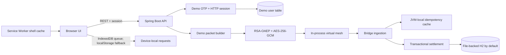

# Architecture

## Request lifecycle

1. The browser saves a request locally. A local queue entry is not a payment authorization or settlement.
2. When online in a local demo session or hosted guest workspace, the client creates a packet through `/api/demo/send`.
3. A gossip round copies packet envelopes through simulated peers with a TTL. Hosted guests gossip only their own packet.
4. A flush submits bridge-held packets to the ingestion service. Hosted guests can flush only their own packet.
5. Bridge ingestion hashes and claims the ciphertext, decrypts the payload, validates freshness, and calls the settlement service.
6. The settlement service checks accounts and funds, then updates sender, receiver, and transaction within one database transaction. The UI displays the server response separately from locally queued state.

## Persistence and deployment

The default local profile uses a file-backed H2 database under `./data`; set `DB_URL`, `DB_USERNAME`, and `DB_PASSWORD` to select a compatible JDBC database with its driver available. `compose.yaml` uses a named Docker volume for this H2 file. The existing Render demo overrides this with in-memory H2, so its ledger resets on service restart. Hosted guest workspace mappings and the idempotency cache are also process-local.

Schema changes are managed by Flyway migrations; Hibernate validates the mapped schema at startup. The OTP challenge store, session workspaces, rate limiter, and idempotency cache are process-local, so this demo is not horizontally scalable. A production deployment would need shared durable storage, distributed session and rate-limit state, backups, and tested migration rollback procedures.

## Security boundary

The sender packet is created server-side to model a phone, and the RSA keypair is regenerated on application startup. The public guest workspace isolates demo records by browser session; it is not a verified identity or persistent account. OTP delivery is simulated; demo payment endpoints are not protected by production user authorization. This architecture is for learning only and must not be used to process real payments.
