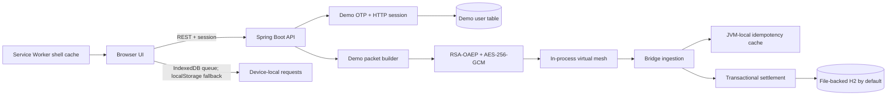

# Architecture

## Request lifecycle

1. The browser saves a request locally. A local queue entry is not a payment authorization or settlement.
2. When online and signed into the demo UI, the client creates a packet through `/api/demo/send`.
3. `/api/mesh/gossip` copies packet envelopes through simulated peers with a TTL.
4. `/api/mesh/flush` submits bridge-held packets to the ingestion service.
5. Bridge ingestion hashes and claims the ciphertext, decrypts the payload, validates freshness, and calls the settlement service.
6. The settlement service checks accounts and funds, then updates sender, receiver, and transaction within one database transaction. The UI displays the server response separately from locally queued state.

## Persistence and deployment

The default profile uses a file-backed H2 database under `./data`; set `DB_URL`, `DB_USERNAME`, and `DB_PASSWORD` to select a JDBC database with its driver available. `compose.yaml` uses a named Docker volume for this H2 file. Automated tests use in-memory objects and do not alter persistent demo records.

Schema management currently uses Hibernate `ddl-auto=update` for the local demo. For production, introduce versioned migrations (such as Flyway), reviewed DDL, backups, and tested rollback procedures before changing schema. The idempotency cache and OTP challenge store remain process-local, so the app is not horizontally scalable or production-secure.

## Security boundary

The sender packet is created server-side to model a phone, and the RSA keypair is regenerated on application startup. OTP delivery is simulated; demo payment endpoints are not protected by user authorization. This architecture is for learning only and must not be used to process real payments.
