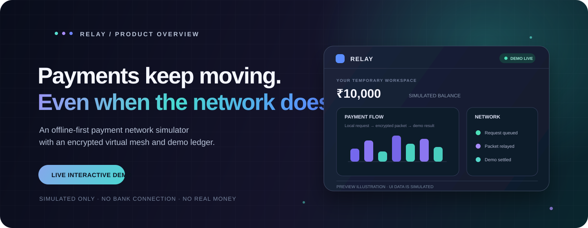
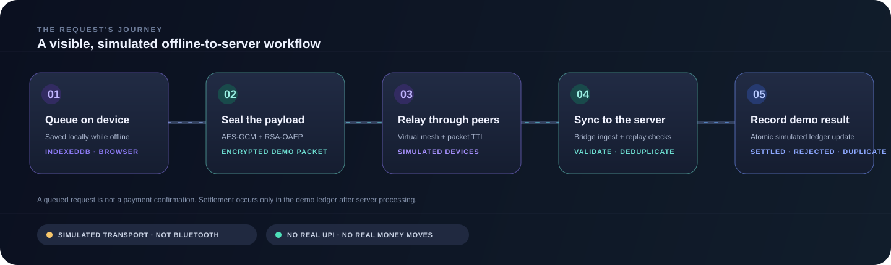

<div align="center">



<p>
  <a href="https://relay-offline-payment-demo.onrender.com/"><strong>▶ OPEN THE LIVE DEMO</strong></a>
  &nbsp;·&nbsp;
  <a href="https://relay-offline-payment-demo.onrender.com/api/health">API health</a>
  &nbsp;·&nbsp;
  <a href="DEMO_SCRIPT.md">Demo walkthrough</a>
</p>


<br>

**A hands-on simulator for a tough question:**<br>
*What should a payment app do when the internet disappears?*

</div>

---

## The short version

**Relay demonstrates an offline-first payment workflow.** A payment request can wait in the browser, become an encrypted packet, travel through simulated peer devices, and reach a server that validates it and records a simulated ledger result.

<div align="center">



<sub>The motion graphic illustrates a software simulation. It is not a recording of real devices communicating.</sub>

</div>

> [!IMPORTANT]
> **Learning project only.** Relay is not UPI, does not connect to banks, and never moves real money. The virtual mesh is simulated in software; it does not use Bluetooth or nearby phones.

## Try the demo

1. Open the [live demo](https://relay-offline-payment-demo.onrender.com/).
2. Enter a display name to start a temporary guest workspace.
3. Explore the wallet, send a simulated payment, and follow its packet through the virtual network.
4. Check the activity and transaction views for the server's simulated result.

Each browser session gets separate demo accounts, activity, and mesh state. This is temporary session isolation, **not** a persistent verified account. Gmail/SMS OTP is not configured. The hosted service may sleep when idle, and its in-memory demo data can reset after a restart.

### What the interface lets you inspect

| View | What it demonstrates |
| --- | --- |
| **Overview** | Demo balance, activity, and recent simulated transactions |
| **Send money** | Create a request up to ₹500 and watch the packet workflow |
| **Offline queue** | Keep a request in browser storage until connectivity returns |
| **Transactions** | Review results recorded by the demo server |
| **Network monitor** | Inspect API health, virtual devices, and sync state |
| **Analytics** | Explore activity and transaction summaries |

## How the workflow is built

```mermaid
flowchart LR
    A[Browser payment request] --> B[IndexedDB offline queue]
    B --> C[AES-GCM encrypted payload]
    C --> D[RSA-OAEP wrapped key]
    D --> E[Virtual peer mesh]
    E --> F[Bridge ingestion]
    F --> G[Freshness and input checks]
    G --> H[Idempotency guard]
    H --> I[Transactional demo ledger]
    I --> J[Result shown in dashboard]
```



### The main engineering ideas

- **Offline-first interaction:** requests can be stored locally in IndexedDB, with a local-storage fallback.
- **Hybrid encryption:** AES-GCM protects the sample payload; RSA-OAEP wraps the packet key.
- **Simulated routing:** virtual devices forward packets with a time-to-live value.
- **Replay and duplicate handling:** ingestion checks packet freshness and uses an idempotency cache.
- **Ledger rules:** settlement validates sender funds and decimal precision, then records the simulated debit and credit transactionally.
- **Public-demo guardrails:** per-session workspaces, a ₹500 transfer cap, request rate limits, and restricted public bridge and mesh controls.
- **Web response protections:** API responses are marked `no-store`; browser security headers include content policy and anti-framing protections.

## Technology

| Layer | Tools |
| --- | --- |
| Backend | Java 17, Spring Boot, Spring Data JPA |
| Frontend | Thymeleaf, JavaScript, HTML, CSS |
| Persistence | H2, Flyway migrations |
| Browser storage | IndexedDB, local-storage fallback |
| Cryptography | AES-GCM, RSA-OAEP, SHA-256 packet hashing |
| Build and packaging | Maven Wrapper, Docker, Docker Compose |
| Hosting | Existing Render Web Service, configured by `render.yaml` |

## Run locally

**Requirements:** Java 17 or newer. Docker is optional.

### Windows PowerShell

```powershell
git clone https://github.com/ankush-48/relay-offline-payment-demo.git
cd relay-offline-payment-demo
.\mvnw.cmd spring-boot:run
```

### macOS or Linux

```bash
git clone https://github.com/ankush-48/relay-offline-payment-demo.git
cd relay-offline-payment-demo
./mvnw spring-boot:run
```

Open [http://localhost:8080](http://localhost:8080). Local demo OTP codes are displayed by the app; they are **not sent** by email or SMS.

### Run with Docker Compose

```bash
docker compose up --build
```

For a guest-only, read-only preview:

```bash
docker compose -f compose.yaml -f compose.preview.yaml up --build
```

## Project map

```text
src/main/java/com/demo/upimesh/
├── config/       Security headers and application setup
├── controller/   Dashboard and REST API
├── crypto/       Packet encryption and server key handling
├── model/        Accounts, packets, and ledger entities
└── service/      Mesh, ingestion, rate limits, and settlement

src/main/resources/
├── db/migration/ Flyway schema
├── static/       Service worker and web app manifest
└── templates/    Interactive dashboard

src/test/         Settlement validation and idempotency concurrency tests
assets/           README product and workflow graphics
```

## Honest demo boundaries

| Included | Not included |
| --- | --- |
| Separate temporary workspaces per browser session | Persistent personal accounts or verified identity |
| A simulated local queue, packet flow, and ledger result | Real UPI, bank, or payment provider connection |
| Rate-limited public demo with amount validation | Real Gmail/SMS OTP delivery |
| H2-backed demo ledger | Durable hosted wallet history across service restarts |
| Simulated peer forwarding | Bluetooth or real phones forwarding packets |

The Render configuration uses an in-memory H2 database. Demo workspaces, sessions, packet keys, and idempotency state can reset when the service restarts. Browser storage is not secure wallet storage. Offline queueing does not reserve funds or guarantee settlement.

## Project documentation

| Guide | Contents |
| --- | --- |
| [Architecture](ARCHITECTURE.md) | Components and request lifecycle |
| [API documentation](API_DOCUMENTATION.md) | Routes, payloads, and error behavior |
| [Offline payment flow](OFFLINE_PAYMENT_FLOW.md) | Offline request and sync stages |
| [Database schema](DATABASE_SCHEMA.md) | Demo ledger tables |
| [Security notes](SECURITY.md) | Guardrails and production limitations |
| [Demo walkthrough](DEMO_SCRIPT.md) | Suggested recruiter demo and talking points |
| [Setup guide](SETUP_GUIDE.md) | Local and Docker setup |


<div align="center">

**Built by Ankush Yadav**<br>
*An exploration of offline-first systems, secure message delivery, and simulated settlement.*

</div>
