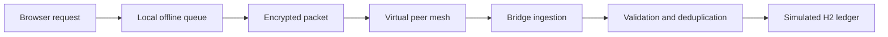

<div align="center">

# RELAY

### Offline-First Payment Network Simulator

**What happens to a payment request when the network disappears?**

Relay is an interactive full-stack demo that follows a payment request from local browser storage through an encrypted virtual mesh to a simulated server ledger.

<br>

[**Open the live demo**](https://relay-offline-payment-demo.onrender.com/) · [**Check API health**](https://relay-offline-payment-demo.onrender.com/api/health)

<br>


</div>

---

## The idea

Most payment demos show a single request and response. Relay makes the steps visible: a request can wait in the browser while offline, become an encrypted packet, pass through simulated peers, and reach a backend that validates and records a **simulated** result.

> **This is a learning project.** Relay is not UPI, does not connect to banks or payment networks, and never moves real money.

## Explore the flow



The interface distinguishes a request waiting on the device from a result returned by the demo server. A queued request is not an authorized or completed payment.

## What you can explore

- **Interactive dashboard** with simulated balances, transactions, charts, and export.
- **Offline request queue** backed by IndexedDB, with a local-storage fallback.
- **Hybrid packet encryption** using AES-GCM for payloads and RSA-OAEP to wrap the encryption key.
- **Virtual mesh routing** across five simulated devices, with packet counts and forwarding state.
- **Server-side ingestion** with freshness checks, duplicate detection, and idempotency.
- **Simulated settlement** with balance validation and transactional ledger updates.
- **Network Monitor** showing API reachability, response time, mesh state, and sync information.
- **Read-only hosted preview** so the public demo cannot submit payment, mesh, or OTP mutations.

## Technology

| Area | Stack |
| --- | --- |
| Backend | Java 17, Spring Boot, Spring Data JPA |
| Frontend | JavaScript, HTML, CSS, Thymeleaf |
| Database | H2 with Flyway migrations |
| Browser storage | IndexedDB with local-storage fallback |
| Encryption | AES-GCM, RSA-OAEP |
| Build and run | Maven Wrapper, Docker, Docker Compose |
| Hosting | Render Web Service, configured with `render.yaml` |

## Run locally

**Requirements:** Java 17 or newer.

### Windows PowerShell

```powershell
git clone https://github.com/ankush-48/relay-offline-payment-demo.git
cd relay-offline-payment-demo
.\mvnw.cmd spring-boot:run
```

### macOS or Linux

```bash
git clone https://github.com/ankush-48/relay-offline-payment-demo.git
cd relay-offline-payment-demo
./mvnw spring-boot:run
```

Open [http://localhost:8080](http://localhost:8080).

The local development run enables the writable simulator. Demo sign-in codes are generated locally; they are **not** sent through Gmail or SMS.

### Run with Docker

```bash
docker compose up --build
```

Open [http://localhost:8080](http://localhost:8080).

To run the guest-only, read-only preview locally:

```bash
docker compose -f compose.yaml -f compose.preview.yaml up --build
```

## Project layout

```text
src/
├── main/
│   ├── java/com/demo/upimesh/
│   │   ├── config/       # Application configuration and security headers
│   │   ├── controller/   # Dashboard and API endpoints
│   │   ├── crypto/       # Packet encryption and server key handling
│   │   ├── model/        # Ledger and packet entities
│   │   └── service/      # Mesh, ingestion, validation, and settlement
│   └── resources/
│       ├── db/migration/ # Database schema migrations
│       ├── static/       # Browser assets and offline support
│       └── templates/    # Dashboard interface
└── test/                 # Settlement validation and concurrency tests
```

## Design and safety notes

- Virtual devices model packet forwarding; they do not use Bluetooth or real handsets.
- The hosted demo runs in read-only mode and reports this at `/api/health`.
- H2 is an in-memory demo database. Its data is not intended to persist across service restarts.
- Demo sign-in is not production authentication and does not deliver a real OTP.
- Browser storage is used for this demo queue, not as secure wallet storage.
- A genuine offline payment system would need a trusted mobile client, a financial authorization model, and integration with regulated payment infrastructure.

## Project guides

- [Architecture](ARCHITECTURE.md)
- [API documentation](API_DOCUMENTATION.md)
- [Offline payment flow](OFFLINE_PAYMENT_FLOW.md)
- [Database schema](DATABASE_SCHEMA.md)
- [Security notes and limitations](SECURITY.md)
- [Demo walkthrough](DEMO_SCRIPT.md)
- [Setup guide](SETUP_GUIDE.md)

---

<div align="center">

**Built by Ankush Yadav**

*An exploration of offline-first systems, secure message delivery, and simulated settlement.*

</div>
